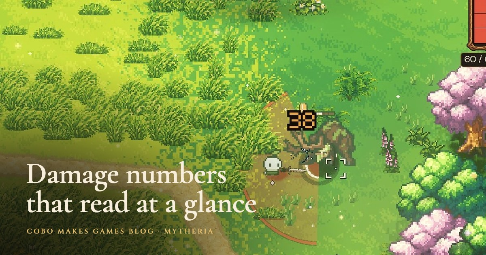
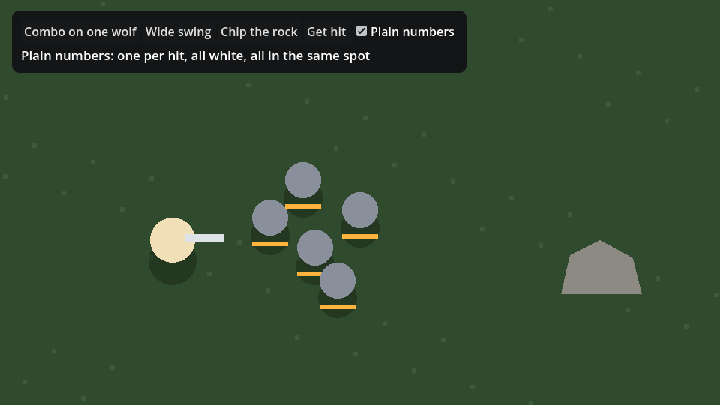

# Damage Numbers for Godot 4



Floating damage numbers that stay readable when a fight gets busy. In a fast fight with several enemies, numbers easily turn into a pile of digits nobody reads. These follow a few small rules, so a glance tells you how hard you're hitting, who got hurt and how close something is to falling.

They're the damage numbers from [Mytheria](https://cobomakesgames.com/mytheria/), our pixel-art co-op game. Why each rule is there is in [damage numbers in games](https://cobomakesgames.com/blog/damage-numbers/).



## The rules

- Every number is whole, and every hit that does damage shows at least 1.
- Hits by the same attacker on one target within 0.6 seconds tick one number up (25, 51, 76, 100) instead of stacking four. A finishing blow closes the number, so the next target starts fresh.
- The colour says who was hurt: cream on trees and rocks, gold on enemies, red on you, green for healing. Pass your own colour for a co-op partner's hits.
- A finishing blow or a hit of 25 or more is one size larger. Resource ticks are one size smaller, so chopping a tree never shouts.
- Each new number takes the nearest free spot of 13 around its target: straight above first, then up, left, right, below and further out. Numbers for different targets never touch, even at the peak of their pop.
- A 5 x 7 pixel font with a one-pixel dark edge keeps them readable over grass, sand or snow without a box behind them.
- Each number pops 35 % larger over 0.12 seconds, rises and is gone in 0.6 seconds, so the screen only holds what just happened. Reduced motion turns off the pop and the rise.

## Install

Copy `addons/damage_numbers` into your project's `addons` folder and enable **Damage Numbers** under Project Settings > Plugins. Godot 4.3 and later (tested on 4.6 and 4.7).

## Use

Add one `DamageNumbers` node to your level. It draws in world space, so give it the same parent as your characters (and set its texture filter to Nearest for crisp pixels). Then call it where damage is dealt:

```gdscript
@onready var numbers: DamageNumbers = $DamageNumbers

func _on_enemy_hit(attacker: Node2D, enemy: Node2D, damage: float) -> void:
	numbers.show_hit(enemy.global_position + Vector2(0, -24), damage,
		DamageNumbers.Tone.DEALT, attacker, enemy, enemy.health <= 0)

func _on_player_hurt(player: Node2D, damage: float) -> void:
	numbers.show_hit(player.global_position + Vector2(0, -24), damage, DamageNumbers.Tone.TAKEN)
```

`show_hit(at, amount, tone, attacker, target, final, color)` returns the number shown, which is the merged total after a merge. Leave `attacker` and `target` out to get a separate number per call. `show_text(at, "Dodged")` places a short word using the same spots.

## Settings

The defaults are Mytheria's: `lifetime` 0.6, `merge_window` 0.6, `rise_speed` 22, `pop_gain` 0.35 over `pop_seconds` 0.12, `big_hit` 25 and `glyph_scale` 3 (each font pixel is 3 screen pixels). The 13 `lanes` are in pixels at glyph scale 3 and grow with it, so bigger text keeps the same gaps. `age_dim` darkens a number as it ages, so the newest hit reads brightest. `reduced_motion` and `limit` (64) are also there. `DamageNumberFont` can be used on its own for any crisp pixel text.

## Demo and tests

Run the project in this repository: combo one wolf, swing at the whole pack, chip the rock, get hit, and switch on **Plain numbers** to compare. The checks run with:

```
godot --headless --path . --script tests/test_damage_numbers.gd
```

## License

MIT, by [Cobo Makes Games](https://cobomakesgames.com). The pixel font is ours too, under the same license. If it helps your game, we'd love to hear about it.
